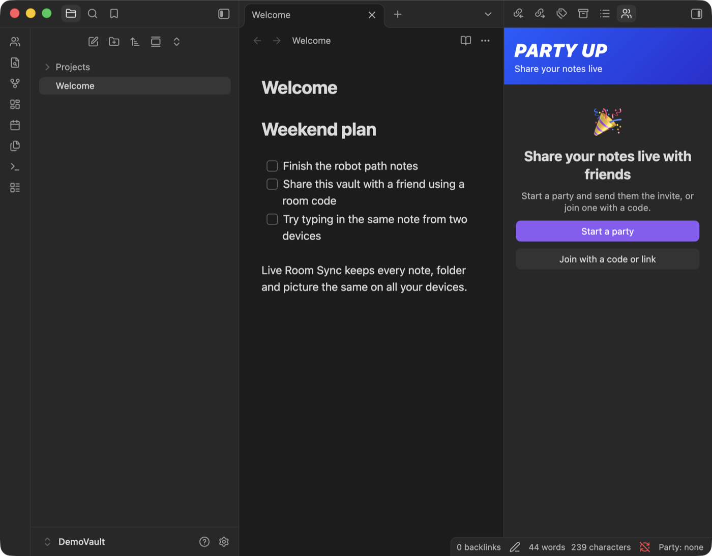
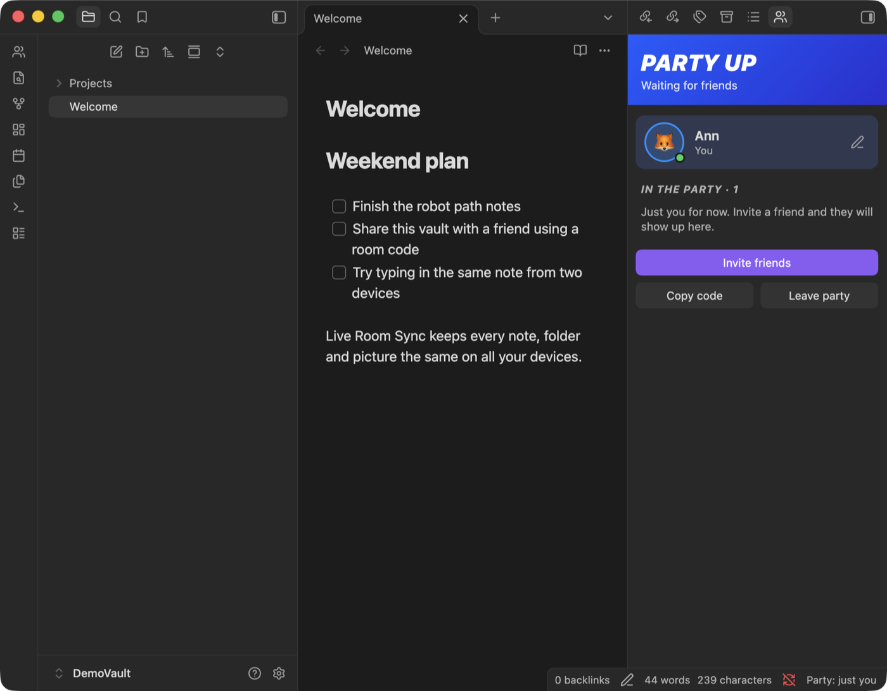
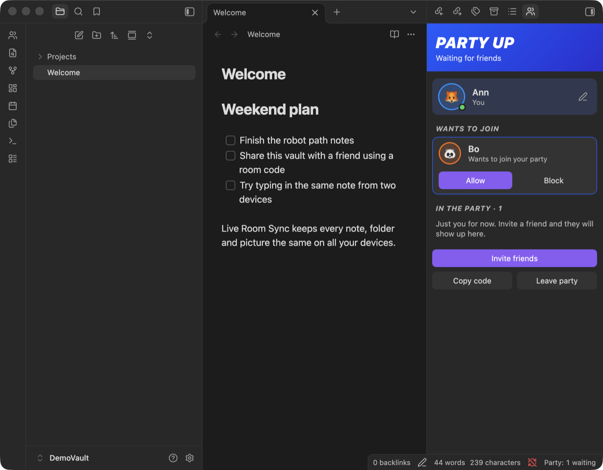
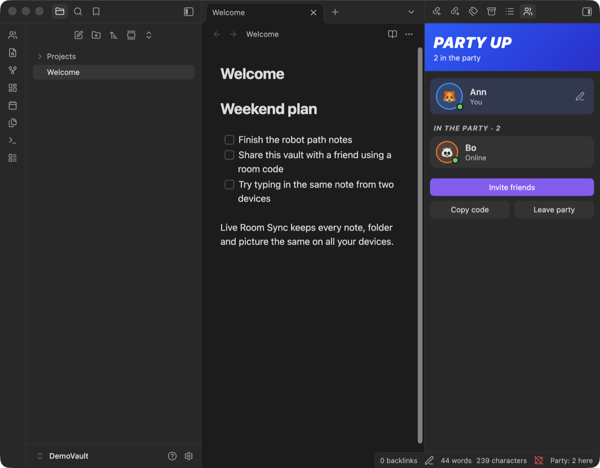
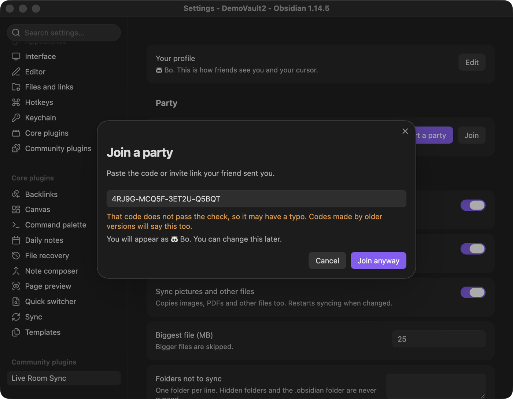

# Live Room Sync

[](LICENSE)


An [Obsidian](https://obsidian.md) plugin that lets you **party up** with friends (or your own devices) and share a whole vault live, with **Google-Docs-style typing**. Start a party, send an invite link, and your friends show up with their name and picture. No account, no server to run, no domain.

> **Status: early (v0.2.0).** It has automated tests and was tried between two Obsidian windows on one Mac, but not yet on phones or across different networks. **Back up your vault before you use it.**

## Screenshots

Real screenshots from Obsidian 1.14.5 on macOS, taken in throwaway demo vaults (Ann and Bo).

**Start.** Open the party panel from the ribbon or the status bar. Start a party, or join one.



**Invite.** Press "Invite friends" to copy a link. Your friends click it, or paste the code.



**Allow.** When someone new joins, you decide. Nothing is shared with them until you press Allow.



**Together.** Everyone in the party, with their picture and a green dot. Notes sync in both directions.



**Typo check.** Codes have a check letter, so a mistyped code is caught before you join an empty room.



**Settings.** Simple on top, technical options folded under "Advanced".


**Live typing.** The same note open on two devices, each with the other's named cursor. (This picture comes from the plugin's browser test page, which uses the same editor code as Obsidian.)


## What it does

- **Party panel.** See who is here, who wants to join, what they are working on, and friends you have partied with before ("Partied together 4d ago").
- **Your profile.** Pick a name, an emoji picture and a color. Friends see them, and your cursor shows as `🐼 Bo` in the note.
- **Easy invites.** One link or one code. Clicking an invite link opens Obsidian and the join dialog.
- **You decide who comes in.** New devices ask to join and you press Allow or Block. Devices prove who they are with a signature, so nobody can pretend to be a device you already allowed.
- **Whole vault sync.** Notes, folders, renames and deletes follow everyone, so graph view, links and backlinks keep working.
- **Live typing.** Open the same note on two devices and see each other's text and cursors in about a second.
- **Attachments.** Images, PDFs and other files sync too (default limit 25 MB on desktop, 10 MB on phones).
- **Offline friendly.** Edit offline; changes merge when you reconnect.
- **Nothing is silently lost.** If two versions of a note truly clash, both are kept. One becomes a new note named like `Note (conflict Mac 2026-11-02 2245).md`.

## Install

### Option A: download a release (easiest)

1. Go to the [Releases page](../../releases) and download `main.js`, `manifest.json` and `styles.css`.
2. In your vault, create the folder `.obsidian/plugins/live-room-sync/` and put the 3 files in it.
   - `.obsidian` is hidden. On macOS press `Cmd + Shift + .` in Finder to show hidden folders. On Windows turn on "Hidden items" in File Explorer.
3. In Obsidian: **Settings → Community plugins**. If "Restricted mode" is on, turn it off. Click the refresh icon, then switch **Live Room Sync** on.

Do this on every device (and every friend does it on theirs). **Everyone must use the same version.** Version 0.2.0 cannot sync with 0.1.x.

### Option B: build from source

```bash
git clone https://github.com/noproblemerr-web/live-room-sync.git
cd live-room-sync
npm install
npm run build        # creates main.js
```

Then copy `main.js`, `manifest.json` and `styles.css` into `<your vault>/.obsidian/plugins/live-room-sync/`.

## Quick start

1. **Back up your vault** (copy the folder somewhere safe). The plugin asks you to confirm this the first time.
2. Click the **people icon** in the left ribbon (or the "Party" item in the status bar) to open the party panel.
3. **You:** press **Start a party**, then **Invite friends**. This copies a link. Send it to your friends.
4. **Friends:** install the plugin, then click your link, or press **Join with a code or link** and paste it.
5. **You:** when "Bo wants to join" appears, press **Allow**. Your notes appear on their side.
6. Open the same note on both and type. Text and named cursors show up on the other side.

Friends should start with an **empty vault** (or a copy of yours) and join the party. The first sync merges what each device has.

## Joining and approval

- A device that joins with your code asks to come in. Until you press **Allow**, it gets none of your notes and you get none of its notes.
- A device you allowed once is remembered (it appears under **Friends**), so it joins without asking next time. Press the **x** next to a friend to forget them.
- **Block** keeps a device out for good, until you forget it.
- The device that just joined with a code trusts the devices it meets for the first 3 minutes, so you only have to approve in one direction.
- Turn off **Ask before new devices join** (Settings → Advanced) if you want anyone with the code to come straight in.
- Approval is tied to a key pair made on each device, not to a name. Changing your name does not give anyone a way to impersonate you.

## How it works

```
Device A  <---- direct WebRTC link ---->  Device B
    \                                      /
     \--- "I am here" hello (find peers) --/
              public relay (Nostr / BitTorrent / MQTT)
```

1. **Party code.** One code is one party. It is random (20 letters, the last one a check letter), so it is not guessable.
2. **Finding each other.** Devices first need to meet. They post a tiny "hello, I am here" message on a free public relay (Nostr by default; BitTorrent trackers and MQTT are alternatives). The relay never sees your notes. The room name it sees is a hash, not your code, and the hello messages are encrypted with a key derived from your code.
3. **Direct link.** After meeting, devices connect straight to each other over WebRTC. Your notes travel device to device.
4. **Who are you.** Each device sends its name, picture and a signed proof of its device key. The other side checks the signature, then asks its owner (or remembers an earlier answer).
5. **Merging.** Each note is a shared document ([Yjs](https://yjs.dev), a CRDT). Edits made at the same time are merged character by character, so nobody's typing is overwritten. Binary files are exchanged by content hash.
6. **Live cursors.** While a note is open, your cursor, name, picture and the note's name are shared with the party (turn the note name off in settings).

## Settings

| Setting | What it does |
| --- | --- |
| **Your profile** | Name, emoji picture and color. |
| **Party** | Start, join, invite, open the panel or leave. |
| **Live typing** | Turn live cursors and keystroke-level sync on or off. |
| **Show which note I am in** | Let friends see "Editing Weekend plan" next to your name. |
| **Sync pictures and other files** | Turn attachment sync on or off. |
| **Biggest file (MB)** | Larger files are skipped. Default 25 (10 on phones). |
| **Folders not to sync** | One folder per line. Hidden folders and `.obsidian` are never synced. |
| **Advanced → Ask before new devices join** | On by default. |
| **Advanced → Network** | How devices find each other: Nostr (default), BitTorrent trackers or MQTT. **Everyone in a party must use the same one.** |
| **Advanced → TURN server** | Optional. JSON like `[{"urls":"turn:example.com:3478","username":"u","credential":"p"}]`. Only for very strict networks. |

## Commands

Open the command palette (`Cmd/Ctrl + P`) and type "Live Room Sync":

- **Open party panel**
- **Copy invite link**
- **Join a party**
- **Copy room code**
- **Reconnect**
- **Check all files now**: rescan the vault and sync anything missed
- **Pause or resume syncing**
- **Copy debug log**: copies a log to your clipboard (useful for bug reports)

## Status bar

Click it to open the party panel.

| Text | Meaning |
| --- | --- |
| `Party: none` | No party yet. Start or join one. |
| `Party: just you` | Connected, waiting for a friend to join. |
| `Party: 1 waiting` | Someone wants to join. Open the panel to allow. |
| `Party: 2 here` | Two people see each other (the number counts you). `· syncing` means changes are still moving. |
| `Party: paused` | Syncing is paused. |
| `Party: error` | Hover for the reason, then try **Reconnect**. |
| `Party: off` / `starting` | Not connected yet. Use **Reconnect**. |

## Limits and things to know

- **Two devices must be online at the same time to sync.** There is no always-on server. To get "always on", leave one computer running with Obsidian open on the vault.
- **Group size.** Every device connects directly to every other (a mesh). It is meant for **a handful of people (about 5)**. It has only been tried with up to 3 devices.
- **Anyone you allow can read, edit and delete the whole vault.** Treat the party code like a password. To lock someone out, leave, start a new party, and invite only the people you still trust. People you removed keep their copy.
- **Privacy.** Devices connect directly over WebRTC, so the devices in a party can see each other's IP addresses, and the public STUN servers see them too. The public relay only sees a hashed room name and encrypted hello messages, plus when you connect.
- **Where the party code lives.** It is saved in plain text in `<vault>/.obsidian/plugins/live-room-sync/data.json`, together with your device key. This plugin never syncs that folder, but if your vault folder is backed up or shared by iCloud, Dropbox or git, they go with it. Keep that folder out of anything public.
- **Public relays are free and can be flaky.** If devices cannot see each other, switch **Network** to another option on **all** devices, or press **Reconnect**.
- **Strict networks** (some schools and offices) can block direct connections. A TURN server may be needed.
- **Deletes sync.** Deleting a note on one device removes it on the others (to the system trash).
- **Not an audited security product.** Keys derived from the code and WebRTC encryption are used, and devices are checked by signature, but there has been no independent security review.
- **Known issue (0.2.0).** The line under a friend's name sometimes shows "Online" instead of "Editing <note>". Notes and cursors are not affected.
- **Big files.** Attachments are loaded into memory as a whole, so very large files are skipped (see the setting above).

## Troubleshooting

- **`Party: just you` forever.** Make sure your friend is open, joined with the *same code* and uses the *same Network* option. Try another Network option on all devices, then **Reconnect**.
- **Friend joined but gets nothing.** They are probably waiting for you to press **Allow** in the party panel.
- **Plugin missing from the list.** Check the path is `<vault>/.obsidian/plugins/live-room-sync/` and that `main.js` and `manifest.json` are directly inside. Turn off Restricted mode and press the refresh icon.
- **A `(conflict ...)` note appeared.** Two versions disagreed. Compare them, keep what you want and delete the other.
- **Something broke.** Run **Copy debug log** and include it in a [GitHub issue](../../issues).

## Development

```bash
npm install
npm run typecheck     # TypeScript check
npm run build         # bundle to main.js
npm test              # sync, join, approval and rename tests
npm run test:smoke    # load the built plugin against a fake Obsidian
npm run test:browser  # live-typing tests in headless Chromium (needs Playwright's Chromium)
```

Source layout:

| File | Purpose |
| --- | --- |
| `src/main.ts` | Obsidian plugin: settings, commands, party actions, status bar |
| `src/ui.ts` | Party panel, join and profile dialogs, settings page |
| `src/settings.ts` | Settings, avatars and colors |
| `src/engine.ts` | Vault sync: scan, merge, conflicts, renames, attachments |
| `src/provider.ts` | Yjs sync over a transport, with the signed hello and approval gate |
| `src/identity.ts` | Device key pair and signatures |
| `src/transport-trystero.ts` | WebRTC transport via [Trystero](https://github.com/dmotz/trystero) |
| `src/cm-binder.ts` | Binds the editor (CodeMirror) to the shared text |
| `src/util.ts` | Diffing, party codes and invite links, hashing, conflict names |

## Credits

Built on [Yjs](https://github.com/yjs/yjs), [y-codemirror.next](https://github.com/yjs/y-codemirror.next), [Trystero](https://github.com/dmotz/trystero) and [diff-match-patch](https://github.com/google/diff-match-patch).

## License

[MIT](LICENSE) © 2026 noproblemerr-web
