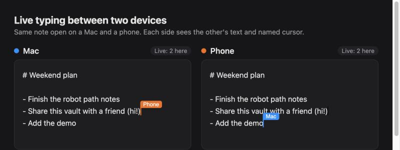
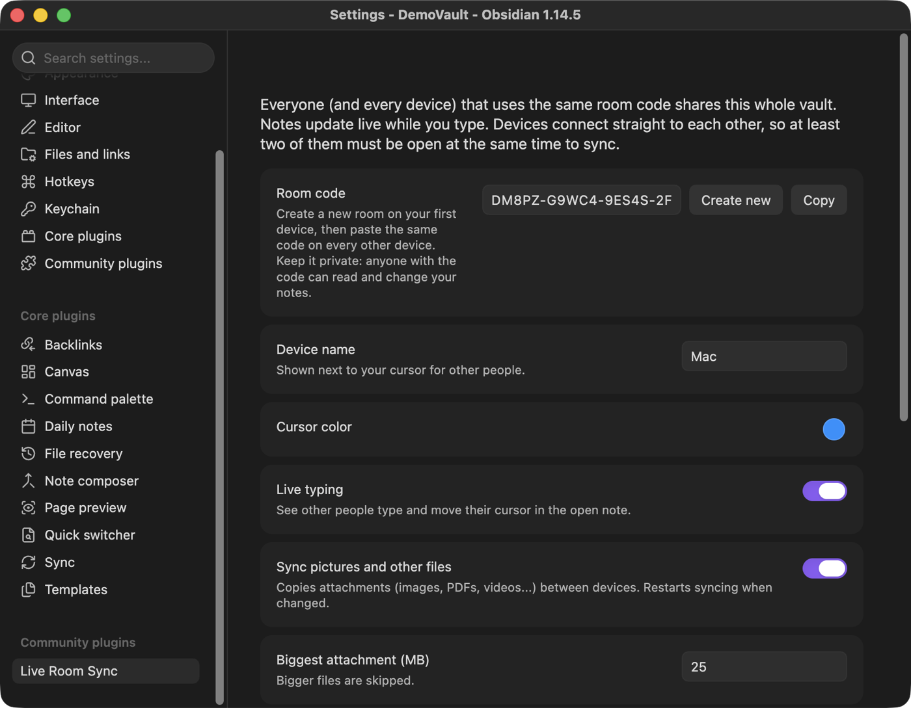
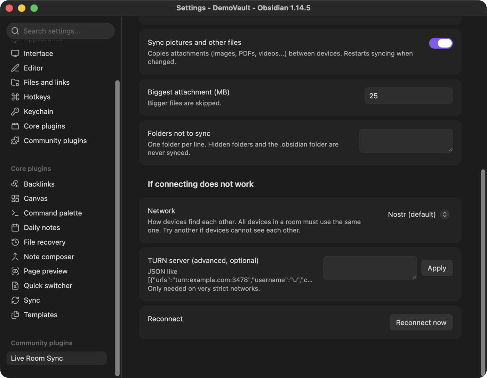
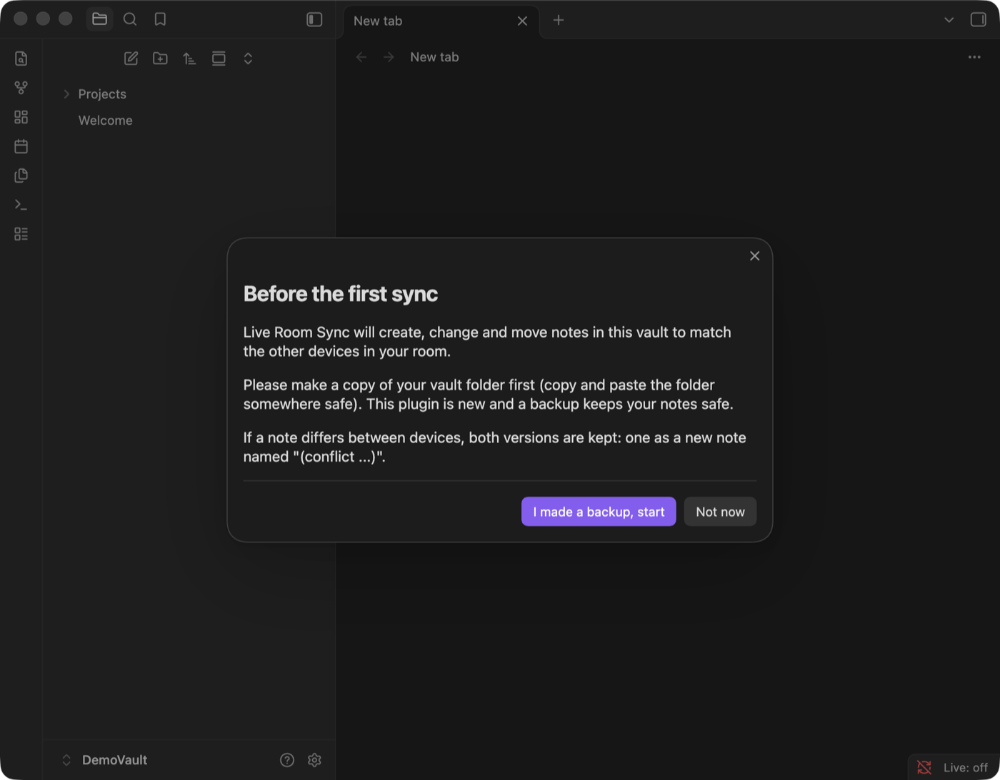
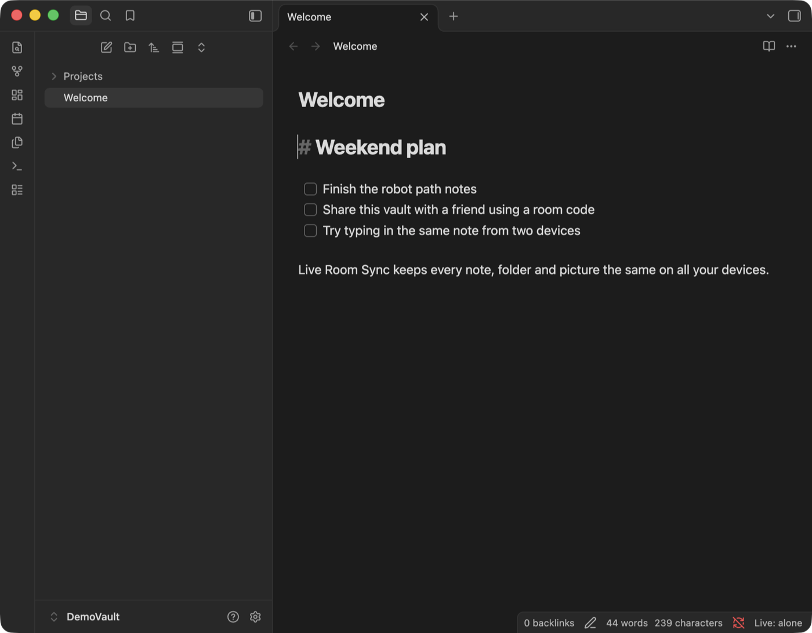
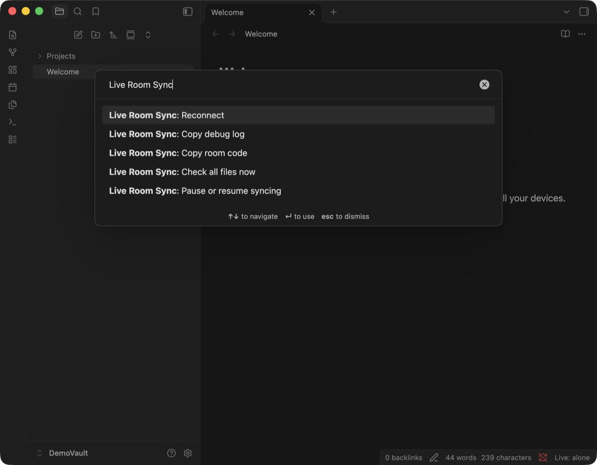
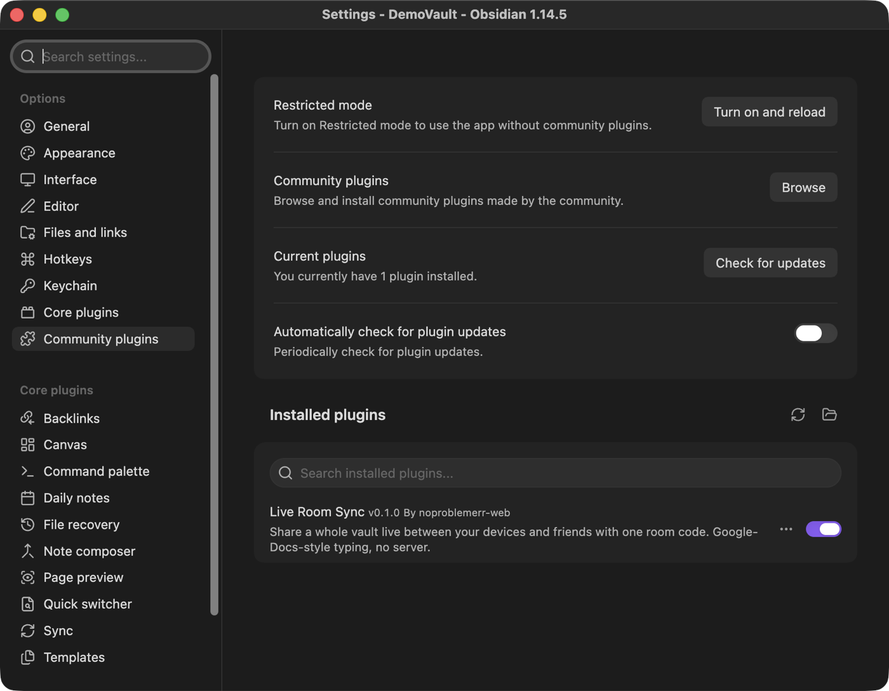

# Live Room Sync

[](LICENSE)


An [Obsidian](https://obsidian.md) plugin that keeps a whole vault in sync between your own devices and a few friends, with **Google-Docs-style live typing**, using nothing but a **room code**. No account, no server to run, no domain.

> **Status: early (v0.1.0).** It has automated tests, but it has not been tested much inside real Obsidian or across real networks yet. **Back up your vault before you use it.**

## What it does

- **Whole vault sync.** Notes, folders, renames and deletes follow you across devices, so graph view, links and backlinks keep working.
- **Live typing.** Open the same note on two devices (or two people) and see each other's text and colored, named cursors appear in about a second.
- **Attachments.** Images, PDFs and other files sync too (default limit 25 MB per file, configurable).
- **Offline friendly.** Edit offline; changes merge when you reconnect.
- **Nothing is silently lost.** If two versions of a note truly clash, both are kept. One becomes a new note named like `Note (conflict Mac 2026-11-02 2245).md`.
- **Built for desktop and mobile** (`isDesktopOnly` is `false`), but mobile has not been tested yet.

## Screenshots

Real screenshots from Obsidian 1.14.5 on macOS, taken in a throwaway demo vault.

**Live typing.** The same note open on two devices. Each side sees the other's text and a named, colored cursor. (This picture comes from the plugin's browser test page, which uses the same editor binding as Obsidian.)



**Settings.** Create a room code, name your device, pick a cursor color and choose what to sync.



**Connection options.** Network choice, optional TURN server, and a reconnect button.



**First run.** The plugin asks you to back up your vault before it syncs anything.



**Status bar.** `Live: alone` means connected and waiting for another device.



**Commands.** Everything is available from the command palette.



**Installed.** The plugin in Settings, Community plugins.



## Install

### Option A: download a release (easiest)

1. Go to the [Releases page](../../releases) and download `main.js`, `manifest.json` and `styles.css`.
2. In your vault, create the folder `.obsidian/plugins/live-room-sync/` and put the 3 files in it.
   - `.obsidian` is hidden. On macOS press `Cmd + Shift + .` in Finder to show hidden folders. On Windows turn on "Hidden items" in File Explorer.
3. In Obsidian: **Settings → Community plugins**. If "Restricted mode" is on, turn it off. Click the refresh icon, then switch **Live Room Sync** on.

Do this on every device (and every friend does it on theirs).

### Option B: build from source

```bash
git clone https://github.com/noproblemerr-web/live-room-sync.git
cd live-room-sync
npm install
npm run build        # creates main.js
```

Then copy `main.js`, `manifest.json` and `styles.css` into `<your vault>/.obsidian/plugins/live-room-sync/`.

## Quick start

1. **Back up your vault** (copy the folder somewhere safe). The plugin asks you to confirm this the first time.
2. **First device:** open the plugin settings and press **Create new** under *Room code*, then **Copy**.
3. **Every other device or friend:** install the plugin, open its settings and paste the **same code**.
4. Look at the status bar at the bottom. `Live: 2 here` means two devices see each other.
5. Open the same note on both and type. Text and cursors should appear on the other side.

Friends should start with an **empty vault** (or a copy of yours) and join the room. The first sync merges what each device has.

## How it works

```
Device A  <---- direct WebRTC link ---->  Device B
    \                                      /
     \--- "I am here" hello (find peers) --/
              public relay (Nostr / BitTorrent / MQTT)
```

1. **Room code.** One code is one room. Everyone with the same code joins the same room. The code is random (20 characters, about 100 bits), so it is not guessable.
2. **Finding each other.** Devices first need to meet. They post a tiny "hello, I am here" message on a free public relay (Nostr by default; BitTorrent trackers and MQTT are alternatives). The relay never sees your notes. The room name it sees is a hash, not your code, and the hello messages are encrypted with a key derived from your code.
3. **Direct link.** After meeting, devices connect straight to each other over WebRTC. Your notes travel device to device.
4. **Merging.** Each note is a shared document ([Yjs](https://yjs.dev), a CRDT). Edits made at the same time are merged character by character, so nobody's typing is overwritten. Binary files are exchanged by content hash.
5. **Live cursors.** While a note is open, your cursor position and device name are shared with the room.

## Settings

| Setting | What it does |
| --- | --- |
| **Room code** | *Create new* makes a fresh code. Paste a code to join an existing room. |
| **Device name** | Shown next to your cursor and in conflict file names. |
| **Cursor color** | Your color for other people. |
| **Live typing** | Turn live cursors and keystroke-level sync on or off. |
| **Sync pictures and other files** | Turn attachment sync on or off. |
| **Biggest attachment (MB)** | Larger files are skipped. Default 25. |
| **Folders not to sync** | One folder per line. Hidden folders and `.obsidian` are never synced. |
| **Network** | How devices find each other: `Nostr` (default), `BitTorrent trackers`, or `MQTT`. **Every device in a room must use the same one.** |
| **TURN server** | Advanced and optional. JSON like `[{"urls":"turn:example.com:3478","username":"u","credential":"p"}]`. Only needed on very strict networks. |
| **Reconnect** | Restart the connection. |

## Commands

Open the command palette (`Cmd/Ctrl + P`) and type "Live Room Sync":

- **Copy room code**
- **Reconnect**
- **Check all files now**: rescan the vault and sync anything missed
- **Pause or resume syncing**
- **Copy debug log**: copies a log to your clipboard (useful for bug reports)

## Status bar

| Text | Meaning |
| --- | --- |
| `Live: no room` | No room code yet. Open settings and create or paste one. |
| `Live: alone` | Connected, waiting for another device to open the vault. |
| `Live: 2 here` | Two devices see each other (the number counts you). `· syncing` means changes are still moving. |
| `Live: paused` | Syncing is paused. |
| `Live: error` | Hover for the reason, then try **Reconnect**. |
| `Live: off` / `starting` | Not connected yet. Use **Reconnect**. |

## Limits and things to know

- **Two devices must be online at the same time to sync.** There is no always-on server. If all devices are closed, nothing syncs until two are open together. To get "always on", leave one computer running with Obsidian open on the vault, or run Obsidian on a small always-on machine.
- **Group size.** Every device connects directly to every other (a mesh). It is meant for **a handful of devices (about 5 people)**. The code does not hard-limit it, but it has only been tested with up to 3 devices.
- **Anyone with the room code can read and edit the whole vault.** Treat the code like a password. To rotate it, create a new code and have everyone paste it. Do not post it publicly.
- **Public relays are free and can be flaky.** If devices cannot see each other, switch **Network** to another option on **all** devices, or press **Reconnect**.
- **Strict networks** (some schools and offices) can block direct connections. A TURN server may be needed.
- **Deletes sync.** Deleting a note on one device removes it on the others (to the system trash).
- **Not an audited security product.** Room-code derived keys and WebRTC encryption are used, but there has been no independent security review.
- **File size.** Very large attachments are skipped (see the setting above).
- **Privacy.** Devices connect directly over WebRTC, so the devices in a room can see each other's IP addresses, and the public STUN servers see them too. The public relay only sees a hashed room name and encrypted hello messages, plus when you connect.
- **Where the room code lives.** It is saved in plain text in `<vault>/.obsidian/plugins/live-room-sync/data.json`. This plugin never syncs that folder, but if your vault folder is backed up or shared by iCloud, Dropbox or git, the code goes with it. Keep that folder out of anything public.
- **No way to remove one person.** Anyone who has the code can read, change and delete notes, and they keep their copy. To lock someone out, make a new code and give it only to the people you still trust.

## Troubleshooting

- **`Live: alone` forever.** Make sure the other device is open, uses the *same code* and the *same Network* option. Try another Network option on all devices, then **Reconnect**.
- **Plugin missing from the list.** Check the path is `<vault>/.obsidian/plugins/live-room-sync/` and that `main.js` and `manifest.json` are directly inside. Turn off Restricted mode and press the refresh icon.
- **A `(conflict ...)` note appeared.** Two versions disagreed. Compare them, keep what you want and delete the other.
- **Something broke.** Run **Copy debug log** and include it in a [GitHub issue](../../issues).

## Development

```bash
npm install
npm run typecheck     # TypeScript check
npm run build         # bundle to main.js
npm test              # sync-engine tests (new files, edits, merges, offline, deletes, renames, images, 3 devices)
npm run test:smoke    # load the built plugin against a fake Obsidian
npm run test:browser  # live-typing tests in headless Chromium (needs Playwright's Chromium)
```

Source layout:

| File | Purpose |
| --- | --- |
| `src/main.ts` | Obsidian plugin: settings, commands, status bar |
| `src/engine.ts` | Vault sync: scan, merge, conflicts, attachments |
| `src/provider.ts` | Yjs document and awareness sync over a transport |
| `src/transport-trystero.ts` | WebRTC transport via [Trystero](https://github.com/dmotz/trystero) |
| `src/cm-binder.ts` | Binds the editor (CodeMirror) to the shared text |
| `src/util.ts` | Diffing, room codes, hashing, conflict names |

## Credits

Built on [Yjs](https://github.com/yjs/yjs), [y-codemirror.next](https://github.com/yjs/y-codemirror.next), [Trystero](https://github.com/dmotz/trystero) and [diff-match-patch](https://github.com/google/diff-match-patch).

## License

[MIT](LICENSE) © 2026 noproblemerr-web
